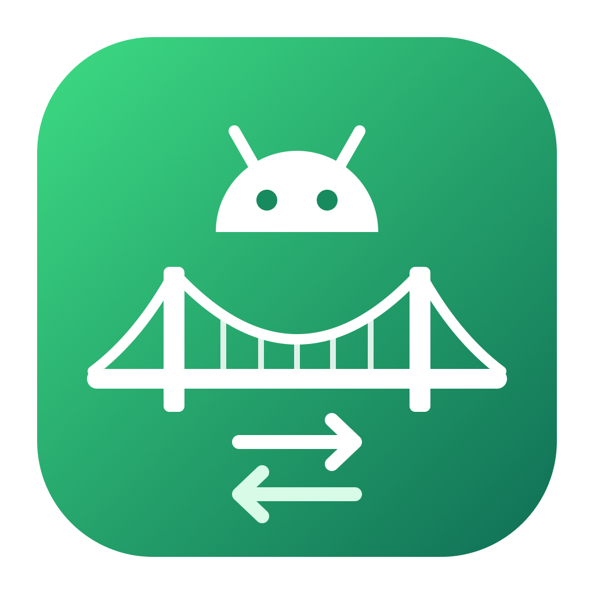

<p align="center">
  
</p>

<h1 align="center">DroidBridge</h1>

<p align="center">Drag and drop files between your Mac and your Android phone.</p>

---

## What DroidBridge helps you with

Macs and Android phones do not work well together out of the box. Finder does not show Android phones, and the old Android File Transfer app is slow and unreliable.

DroidBridge fixes that with a simple Finder-style window:

- **Copy files to your phone** - drag files or whole folders from Finder into DroidBridge.
- **Copy files to your Mac** - drag files from DroidBridge straight into a Finder window.
- **Browse your phone** - open folders, switch between list and grid view, and see sizes and dates.
- **Tidy up** - rename, delete, or create folders on your phone without touching it.
- **Use several devices at once** - phones, tablets and emulators all appear in one list.

Typical uses:

- Moving photos and videos off your phone to free up space
- Copying music, PDFs or documents onto your phone or tablet
- Backing up a folder (for example WhatsApp media or Downloads) to your Mac
- For developers: pushing test files to a device or emulator, and pulling logs and screenshots back

## Features

- Drag and drop in both directions, including whole folders
- Transfer list with progress for every copy, so you know when it is done
- Right-click menu: Open, Download, Download to..., Rename, Copy path, Delete
- Finder-style keyboard shortcuts (arrows, Shift+arrows, Cmd+A, Enter, Cmd+Up, Cmd+Backspace)
- Two ways to connect:
  - **USB debugging (ADB)** - fastest, and shows the whole file system
  - **File transfer (MTP)** - the phone's normal USB mode, no developer settings needed
- Built-in, step-by-step guides for connecting a phone either way
- Works with phones over USB, over Wi-Fi (ADB), and with Android emulators
- Light and dark mode, following your Mac's setting
- Help menu with Check for Updates and About

## What you need

- A Mac running a recent version of macOS
- An Android phone or tablet, and a USB cable that supports data (some cables only charge)
- For **USB debugging (ADB)**: Android platform-tools. If you have Android Studio, you already have them. Otherwise install them with [Homebrew](https://brew.sh):

  ```bash
  brew install android-platform-tools
  ```

- For **File transfer (MTP)**: the free libmtp library:

  ```bash
  brew install libmtp
  ```

You only need one of the two.

## Getting started

### 1. Get DroidBridge

Ready-made downloads will be published on the [Releases](https://github.com/RANZN/DroidBridge/releases) page. Until then, run it from the source code:

```bash
git clone https://github.com/RANZN/DroidBridge.git
```

```bash
cd DroidBridge && ./kotlin run -m desktopApp
```

The `./kotlin` script downloads everything it needs the first time, so this first run takes a few minutes.

### 2. Connect your phone

When no phone is connected, DroidBridge shows a setup guide. You can reopen it at any time from **Help > DroidBridge Help**, or from **How to connect a device** at the bottom of the device list.

**Option A - USB debugging (recommended)**

1. On the phone, open **Settings > About phone** and tap **Build number** 7 times.
2. Open **Settings > System > Developer options** and turn on **USB debugging**.
3. Connect the phone to your Mac, unlock it, and tap **Allow** on the "Allow USB debugging?" prompt.

**Option B - File transfer (MTP)**

1. Turn on **MTP devices** at the bottom of DroidBridge's device list.
2. Connect the phone and unlock it.
3. Tap the **USB** notification on the phone and choose **File transfer**.

If MTP has not connected after a minute, DroidBridge suggests switching to USB debugging.

### 3. Copy files

- **Mac to phone** - drag files or folders from Finder onto the DroidBridge window. They go into the folder you are viewing.
- **Phone to Mac** - drag items from DroidBridge into Finder, or select them and click **Download**.

## USB debugging or File transfer?

| | USB debugging (ADB) | File transfer (MTP) |
|---|---|---|
| Setup on the phone | Developer options + USB debugging | Choose "File transfer" in the USB notification |
| Setup on the Mac | Android platform-tools | libmtp |
| What you can see | The whole file system | Shared storage only (photos, downloads, documents) |
| Speed | Fastest | Slower |
| Wi-Fi and emulators | Yes | No, USB only |

## Common questions

**My phone does not appear.**
Check that the cable supports data, that the phone is unlocked, and (for ADB) that you tapped Allow on the USB debugging prompt. Try another USB port, or unplug and reconnect.

**My phone shows as "Unauthorised".**
Unlock the phone and look for the "Allow USB debugging?" prompt. If it does not appear, unplug and reconnect the cable.

**My phone shows as "Busy" (MTP).**
Another Mac app is using the phone. Quit Android File Transfer, OpenMTP, Image Capture and Photos. If it is still busy, run `killall ptpcamerad` in Terminal and reconnect the phone.

**Dragging a large file into Finder takes a moment before the copy appears.**
Finder needs the file to exist on your Mac first, so DroidBridge copies it from the phone when you drop it. The Transfers panel shows the progress.

**Is my data sent anywhere?**
No. Files go directly between your Mac and your phone over the cable (or your local Wi-Fi for wireless debugging). The only internet request is the optional Check for Updates, which asks GitHub for the latest version number.

## Feedback and support

Found a problem or have an idea? Open an issue on [GitHub](https://github.com/RANZN/DroidBridge/issues).

## For developers

Build instructions, architecture and tests are in [DEVELOPMENT.md](DEVELOPMENT.md).

## Licence

DroidBridge is released under the [Apache License 2.0](LICENSE).
